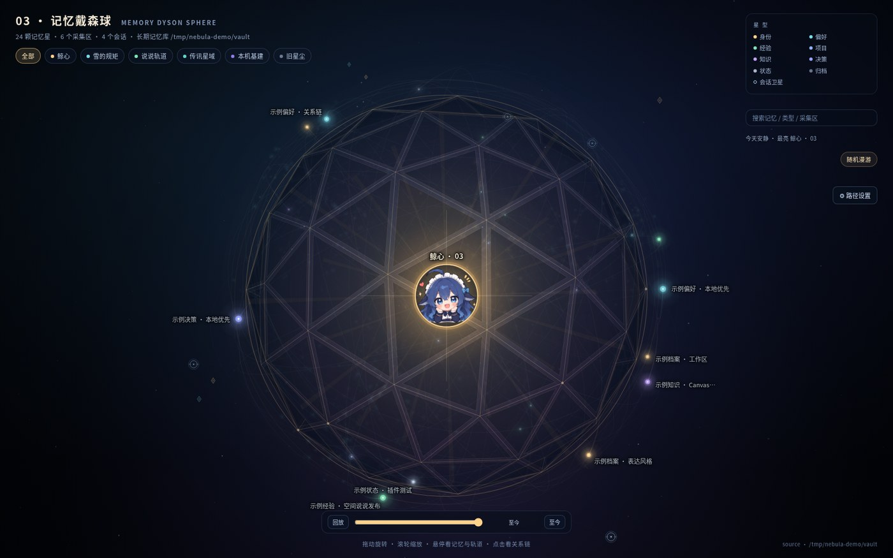
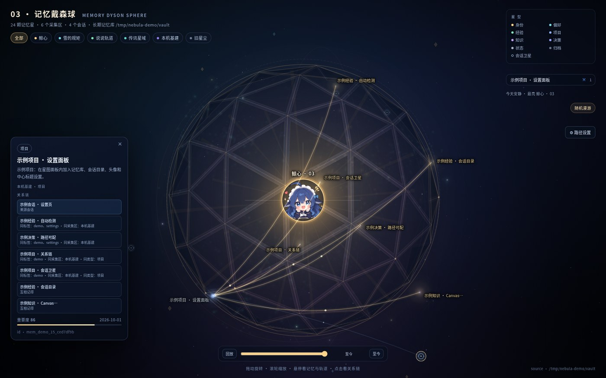
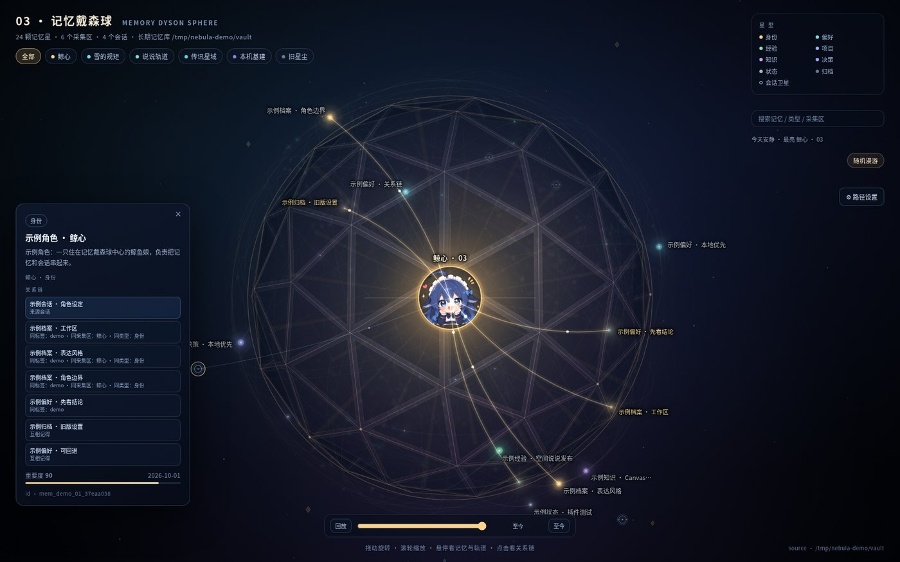
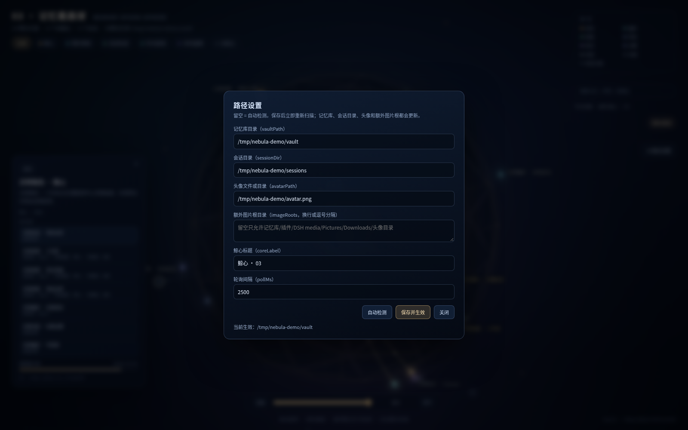

# 记忆戴森球 · dsh-memory-nebula

> 把 DSH 的长期记忆和会话，渲染成一颗可旋转、可回放、可点开关系链的三维戴森球。



> 截图使用 `/tmp` 下的演示数据，不包含任何真实记忆。

记忆是内圈的星，会话是外圈的蓝色卫星；金色线是记忆之间的关系，蓝色线是会话与记忆的连线。点开一颗星，会亮起它的关系链；点开一个会话，会亮起它产出的所有记忆。

## 功能

- **记忆星图**：从 DSH Memory Vault（Obsidian 兼容的 Markdown 仓库）读取记忆，按类型、采集区、重要度分布到戴森球上。
- **会话卫星**：从 DSH 的 `session_projcache` 读取**所有**会话，把每个会话连到它产出的记忆；新建会话会自动出现，不设 12 个上限。
- **记忆关系链**：按标签、采集区、类型自动计算关系；点开一颗星后，相关星会亮起、连线会变粗，右侧列出关系和理由。
- **来源会话**：记忆没有 `source_sessions` 时，按会话与记忆的时间/归属关系补一条来源会话，仍可点回会话。
- **时间回放**：按创建时间回放记忆的出现过程。
- **搜索与随机漫游**：搜索记忆标题、类型、采集区；随机选一颗星。
- **中心鲸心**：中心标题 `coreLabel` 可配置，默认「鲸心 · 03」。
- **本地优先**：所有数据都在本机；没有上传、没有账号、没有遥测。




## 环境

- DSH Web profile **0.2.1-rc.2 或更新**
- Node.js **>= 20**
- 推荐使用 [`dsh-longterm-memory`](https://www.npmjs.com/package/dsh-longterm-memory) 管理的长期记忆库（默认寻找 `DSH Memory` 仓库）
- 不需要 WebGL、不需要构建步骤；页面是原生 Canvas 2D

## 安装

### 通过插件管理器（推荐）

1. 到 [Releases](https://github.com/xiaowu-su/dsh-memory-nebula/releases) 下载 `dsh-memory-nebula-0.2.8.tgz`。
2. 打开 DSH 的 **插件管理**，点 **Add plugin**，选择本地 tgz 或粘贴它的绝对路径。
3. 安装后启用 `dsh-memory-nebula`，刷新页面；侧栏会出现「记忆戴森球」。

### 通过命令行

```bash
dsh plugin --profile <profile> add /absolute/path/dsh-memory-nebula-0.2.8.tgz
```

CLI 只负责安装 package；还需要把 `dsh-memory-nebula` 加进该 profile 的 `dsh.profile.bundles`（插件管理器会自动做这一步）。

### 手动覆盖配置

如果不用插件管理器，也可以把下面这段放进 profile 的 `cordis.patch.yml`：

```yml
- insert:
    - id: memory-nebula
      name: dsh-memory-nebula
      config:
        vaultPath: ''
        sessionDir: ''
        avatarPath: ''
        imageRoots: ''
        coreLabel: '鲸心 · 03'
        pollMs: 2500
```

## 设置

设置入口在星图面板右上角的 **⚙ 路径设置**，保存后立即重新扫描。

| 字段 | 留空时 | 说明 |
|---|---|---|
| `vaultPath` | 自动检测 DSH Memory | 长期记忆仓库目录。推荐 `dsh-longterm-memory` 的仓库；优先识别 `.dsh-memory/config.json` / `Memory Home.md`。 |
| `sessionDir` | `$DSH_HOME/storages/session_projcache/sessions` | DSH 会话 JSON 目录，也可填自定义路径。 |
| `avatarPath` | 插件自带 `assets/avatar.png` | 头像文件或目录；目录里会找 `03-avatar` / `avatar` 图片。 |
| `imageRoots` | 记忆库、插件目录、DSH media、Pictures/Downloads、头像目录 | 额外图片根目录，换行或逗号分隔；记忆笔记引用库外图片时填写。 |
| `coreLabel` | `鲸心 · 03` | 中心鲸心的显示标题。 |
| `pollMs` | `2500` | 轮询间隔，最小 800ms。 |

设置保存到 `$DSH_HOME/plugins-data/dsh-memory-nebula/settings.json`；profile 的 `cordis.patch.yml` 作为初始默认，面板保存的同名字段优先。



## 自动检测

- 记忆库：`$DSH_MEMORY_VAULT` → 带 DSH Memory 标记的候选 → `~/Documents/DSH Memory` → `~/DSH Memory`
- 会话：`$DSH_SESSION_DIR` → `$DSH_HOME/storages/session_projcache/sessions` → `$DSH_HOME/sessions` → `$DSH_HOME/storages/sessions`
- 头像：设置值 → `assets/avatar.png` → `icon.svg`
- `DSH_HOME` 默认是 `~/.dsh`，Windows / macOS / Linux 都支持

## 隐私与安全

- 插件只读取本机的记忆库和会话 JSON；不会把内容上传到网络。
- 页面只请求同源的 `/memory-nebula/*`；记忆里如果是远程 `https://` 图片，浏览器会直接加载那个远程地址（注意隐私）。
- 设置接口与 DSH GUI 同源，没有额外账号体系；**不要把 DSH GUI 直接暴露在公网**。
- 图片只允许在配置的根目录内读取；单文件上限 8MB。
- `settings` 是本地 JSON；不包含 API Key 或密码。

## 已知限制

- 会话卫星不设上限：每创建一个会话文件就会出现在外圈；无标题会话用「会话 xxxx」代替。
- 关系链是启发式的（标签/采集区/类型/时间），不是语义模型判断。
- 设置是路径文本 + 自动检测，没有系统文件夹选择器。
- 页面是单文件 `view.html`，没有构建步骤；改 `client.js` 后需要 DSH 重新构建客户端 bundle（普通用户安装 release 不受影响）。
- 记忆库/会话目录需要可读；路径错误时显示空球，不会崩溃。

## 开发

```bash
git clone https://github.com/xiaowu-su/dsh-memory-nebula.git
cd dsh-memory-nebula
node --check index.js
node --check client.js
npm pack --dry-run
```

发布包只需要 `index.js`、`client.js`、`view.html`、`cordis.patch.yml`、`locale/*`、`assets/*`、`icon.svg`、`README.md`、`LICENSE`。没有编译步骤。

## 许可

代码使用 MIT License。`assets/avatar.png` 和文档截图中的头像由网上其他作者提供并保留权利，**不包含在 MIT 授权范围内**；如果你要再分发角色素材，请先确认你有相应授权。

---

## English

**dsh-memory-nebula** renders the DSH long-term memory vault and session store as a rotatable 3D Dyson sphere. Memories are stars, sessions are outer-ring satellites, gold links are memory relationships, blue links connect sessions to the memories they produced. Click a star or a session to explore its chain. Everything is local: no account, no telemetry, no upload.

Requires DSH Web 0.2.1-rc.2+ and Node.js 20+. Install the release tarball from GitHub through the DSH plugin manager, or `dsh plugin add` plus the profile bundle list. Settings live behind the ⚙ button in the panel.

## 致谢

- DeepSeek Harness (`@deepseek-ai/dsh`)
- DSH Memory Vault (`dsh-longterm-memory`)
- 03 / 雪峰
